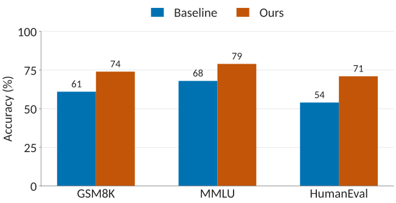

# Example Section

## Example Frame

Something something

- More items
- Even more items
  - A sub-item, with an [alerted]{.alert} word

Or equations like (pasted unchanged from the beamer example deck)

\begin{equation}
    \label{eq:example}
    \min_{x \in \mathbb{R}^n} \ f(x) \quad \text{subject to} \quad g(x) \leq 0
\end{equation}

and referenced as \eqref{eq:example}.

## Macros

Macros from `_theme/macros.tex` work in any math:

\begin{equation}
  \label{eq:erm}
  \hat{\bm\theta} = \argmin_{\bm\theta \in \R^d} \; \E_{(x,y)\sim\mathcal{D}}
  \left[ \ell(f_{\bm\theta}(x), y) \right] + \lambda \norm{\bm\theta}_2^2
\end{equation}

Numbering continues across slides, so \eqref{eq:erm} follows \eqref{eq:example}.
Unnumbered display math uses `$$ ... $$`; inline math uses `$...$`, e.g.
$\bm{x} \in \R^n$ and `mathtools`' $\coloneqq$.

## Citations

- Narrative (natbib `\citet`): @mialon2024gaia introduced GAIA;
  @wei2025browsecomp followed with BrowseComp.
- Parenthetical (natbib `\citep`): agent benchmarks keep getting harder
  [@phan2025humanity; @jimenez2024swe].
- With a locator: [@kwa2026measuring, Fig. 2]. A blog post: [@openai2026gpt6].

::: {.mainblock title="Prompt"}
`\mainblock{Prompt}{...}` becomes a `mainblock` div. Bibliography entries for every
cited key are collected on the References slide.
:::

## Blocks and boxes

:::: columns
::: column
::: {.block title="Block"}
A beamer `block`.
:::
::: {.exampleblock title="Example block"}
`exampleblock` looks the same as `block`.
:::
:::
::: column
::: {.alertblock title="Alert block"}
`alertblock`, the same box as `mainblock` / `\mainblock{T}{body}`.
:::
::: boxedblock
`boxedblock`: an untitled, centred takeaway.
:::
:::
::::

## Method Comparison

{fig-align="center"}

# Media

## Embedded video: autoplay, loop, muted

{.autoplay .loop .muted .center width="70%"}

Starts when the slide opens, loops, no sound, no controls. Add `.controls` for a
player bar.

## Full-screen video background {.video-overlay background-video="media/background.mp4" background-video-loop="true" background-video-muted="true"}

- `background-video` on the slide header fills the whole slide
- `background-video-loop` / `background-video-muted` as needed
- The `.video-overlay` class turns text white for dark footage

## Two videos side by side

:::: columns
::: column
{.autoplay .loop .muted width="100%"}

Conway's Game of Life
:::
::: column
{.autoplay .loop .muted width="100%"}

Elementary automaton, rule 110
:::
::::

# Wrap-up

## Two-column layout

:::: columns
::: {.column width="55%"}
**Left column**

- Columns take a `width`
- Anything goes inside: lists, math, figures
- $\E[\bm{x}] = \bm\mu$
:::
::: {.column width="45%"}
**Right column**

| Method   | Score |
|----------|------:|
| Baseline |  41.2 |
| Ours     | **57.9** |
:::
::::

## References {.scrollable}

::: {#refs}
:::
